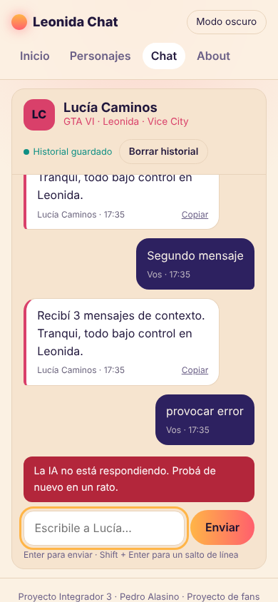
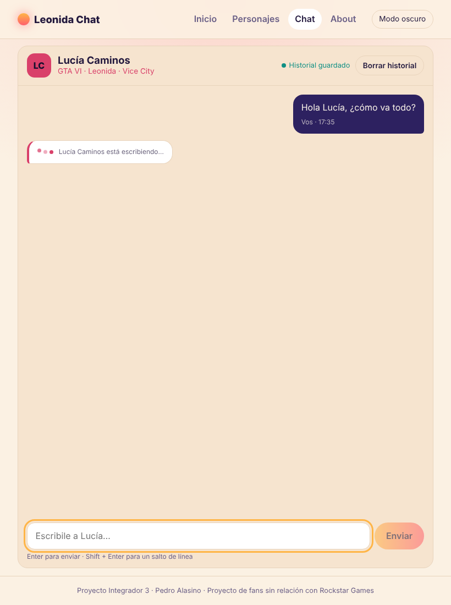
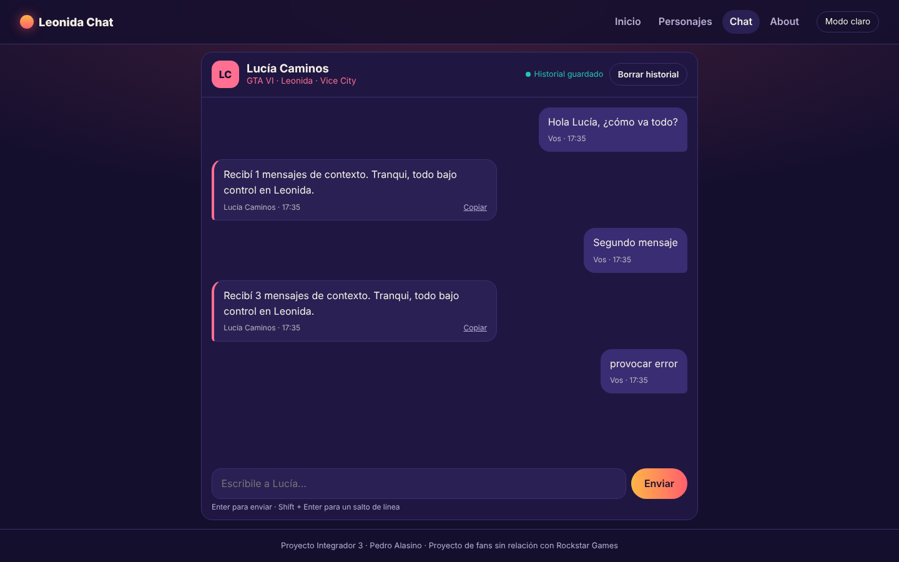
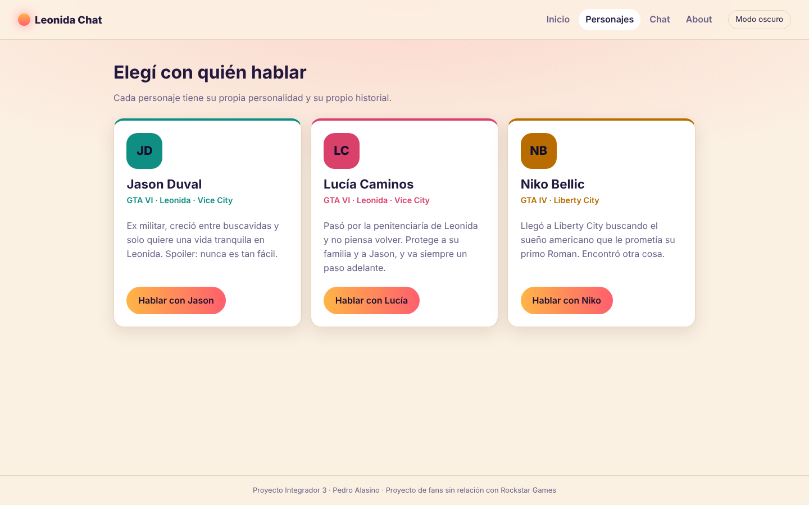

# Leonida Chat · Chateá con personajes de GTA

Proyecto Integrador 3 (Henry). Single Page Application responsive para chatear con personajes de Grand Theft Auto usando **Google Gemini**, a través de una **Vercel Serverless Function** que protege la API key.

🔗 **App desplegada:** https://pi3-chat.vercel.app

## Los personajes

| Personaje | Juego | Personalidad |
| --- | --- | --- |
| **Jason Duval** (principal) | GTA VI | Ex militar, tranquilo, de pocas palabras y con humor seco. Quiere una vida tranquila en Leonida, pero nunca es tan fácil. |
| **Lucía Caminos** | GTA VI | Directa, ambiciosa y protectora. Pasó por la penitenciaría de Leonida y no piensa volver. |
| **Niko Bellic** | GTA IV | Veterano de guerra, cínico y con humor negro. Llegó a Liberty City buscando el sueño americano. |

Cada personaje tiene su propio system prompt en `api/_personajes.js`. Ahí se define cómo habla, qué sabe y sus límites: respuestas cortas de 1 a 3 oraciones, siempre en personaje, apto para todo público y sin inventar spoilers.

## Funcionalidades

- Routing SPA con History API: `/home`, `/personajes`, `/chat?personaje=...`, `/about`, con los botones atrás y adelante del navegador funcionando.
- Chat con mensajes del usuario y del personaje bien diferenciados, indicador animado de "escribiendo…", manejo de errores y scroll automático.
- El historial completo se manda en cada request para que el personaje mantenga el contexto.
- La API key nunca llega al navegador: el frontend llama a `/api/functions` y esa función llama a Gemini.
- Diseño mobile-first con breakpoints en **768px** (tablet) y **1100px** (desktop).

### Extra credit implementado

1. **Historial en localStorage:** se guarda por personaje, se recupera al recargar, tiene un botón "Borrar historial" y un indicador de "Historial guardado".
2. **Varios personajes:** galería con 3 tarjetas, cada personaje con su propio prompt.
3. **Extras de UI:** horario en cada mensaje, Enter para enviar (Shift + Enter para un salto de línea), botón para copiar respuestas y modo claro/oscuro.

## Capturas

| Mobile | Tablet | Desktop |
| --- | --- | --- |
|  |  |  |



## Estructura

```
api/
  functions.js      # Serverless Function: proxy seguro a Gemini
  _personajes.js    # System prompts (no es un endpoint por empezar con "_")
src/
  index.html
  styles.css        # Mobile-first + media queries
  app.js            # Routing SPA, vistas y tema claro/oscuro
  chat.js           # Lógica del chat, fetch y localStorage
  personajes.js     # Datos visibles de cada personaje
  utils.js          # Transformación y validación de datos
tests/
  utils.test.js
  app.test.js
.env.example
vercel.json
```

## Ejecutar en local

**Requisitos:** Node.js 18 o superior, una cuenta de Vercel y una API key de [Google AI Studio](https://aistudio.google.com/apikey).

```bash
# 1. Instalar dependencias
npm install

# 2. Instalar la CLI de Vercel (una sola vez)
npm install -g vercel

# 3. Crear el archivo .env a partir del ejemplo y poner tu API key
cp .env.example .env
#   GEMINI_API_KEY=tu_clave
#   GEMINI_MODEL=   (opcional, por defecto gemini-3.5-flash-lite)

# 4. Levantar el frontend + la serverless function
vercel dev
```

Abrí la URL que muestra la terminal (normalmente http://localhost:3000).

> Con `npm run dev` solo se levanta el frontend: el chat va a mostrar un error porque falta la función `/api/functions`. Para probar todo junto, usá `vercel dev`.

## Tests

```bash
npm test
```

Son 21 tests con Vitest, sin acceso a internet porque `fetch` está mockeado. Cubren:

- La validación y la transformación del historial al formato de Gemini.
- El parseo de la respuesta de la API y el escape de HTML.
- El routing: qué vista y qué personaje corresponden a cada URL.
- El envío al backend con éxito, con error del servidor y sin conexión.
- El historial en localStorage.
- La serverless function: método, personaje inválido, llamada a Gemini y límite 429.

## Deploy en Vercel

1. Subí el repositorio a GitHub, en modo público.
2. En [vercel.com](https://vercel.com), elegí **Add New → Project** e importá el repositorio. `vercel.json` ya define el build (`npm run build`), la carpeta de salida (`dist`) y las reglas para que funcionen las rutas de la SPA.
3. En **Settings → Environment Variables**, agregá `GEMINI_API_KEY` con tu clave.
4. Hacé **Deploy** y probá el chat en la URL pública.

## Seguridad

- `.env` está en `.gitignore`: la clave nunca se sube al repositorio.
- Los system prompts viven en el servidor, así que el usuario no los puede modificar.
- La función valida el método HTTP, el personaje y el historial, y corta el contexto en los últimos 20 mensajes.
- Todo el texto del chat se escapa antes de mostrarse, para evitar inyección de HTML.

## Registro del uso de IA

Usé **Claude (Anthropic)** como asistente durante el desarrollo.

| Para qué | Prompt (resumido) | Cómo influyó y qué decidí |
| --- | --- | --- |
| Planificar | "Armame el PI3 según esta consigna, con Jason de GTA VI y los 3 extra credit" | Me propuso una estructura en `api/` y `src/`. Mantuve la que pide la consigna y separé los prompts en `api/_personajes.js` para que no lleguen al navegador. |
| Elegir modelo | "¿Qué modelo de Gemini uso hoy?" | Revisamos la documentación oficial y elegí `gemini-3.5-flash-lite`, configurable con `GEMINI_MODEL`. |
| System prompts | "Definí la personalidad de Jason, Lucía y Niko con respuestas cortas" | Agregué reglas comunes: siempre en personaje, apto para todo público, sin inventar spoilers y sin dar información peligrosa. |
| Tests | "Tests de utils, routing y la función con fetch mockeado" | Usé `vi.fn()` y `vi.stubGlobal` para testear sin red. |
| Revisión | "Probalo en mobile, tablet y desktop" | Revisamos las capturas, los botones atrás y adelante y el estado de error en un navegador. |

---

Proyecto educativo de fans, sin relación con Rockstar Games ni Take-Two Interactive.
